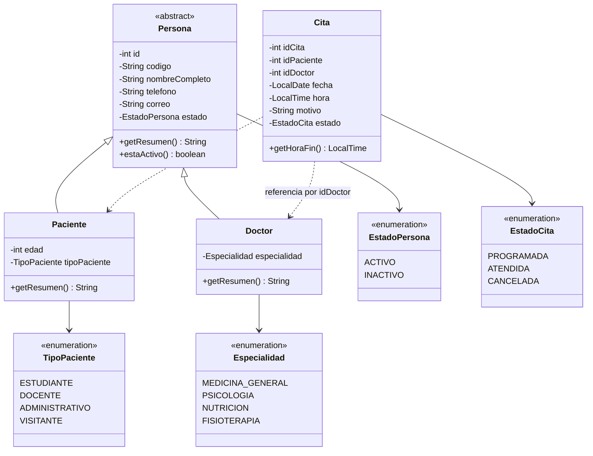
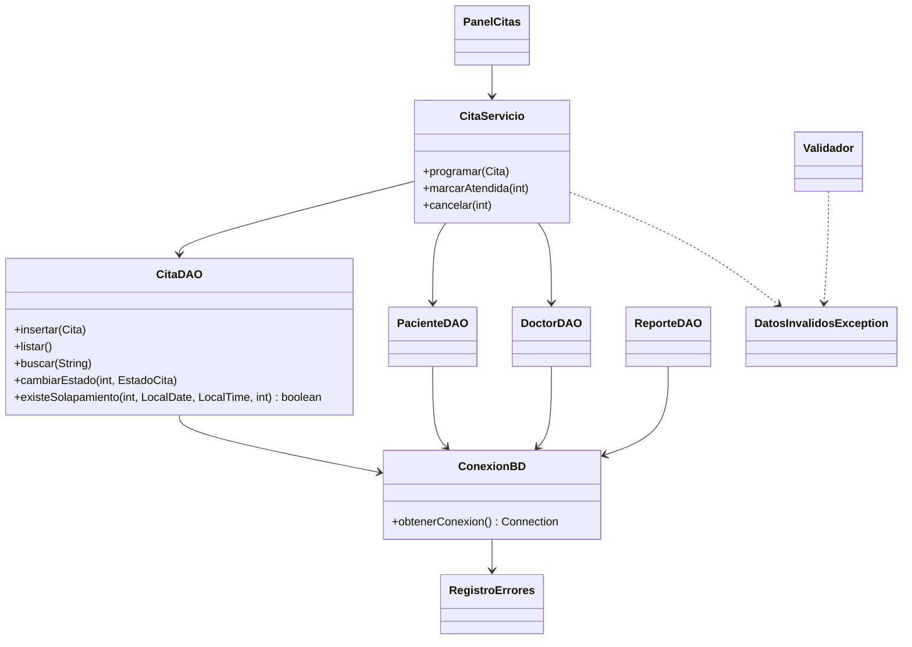
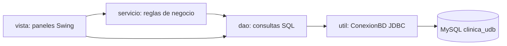
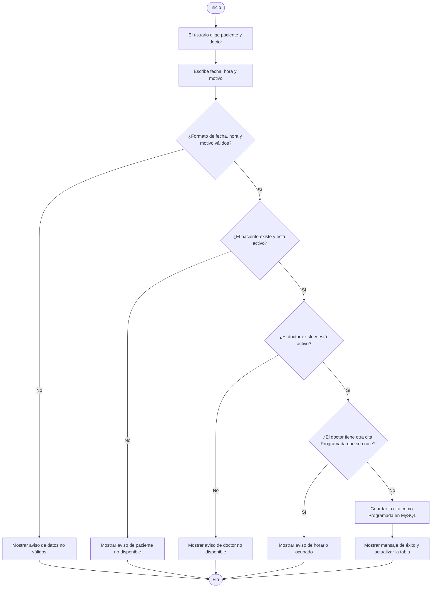

# Diagramas

Los diagramas de casos de uso y el modelo entidad-relación están en el
documento PDF. Aquí se incluyen el diagrama de clases, la arquitectura por
capas y el diagrama de actividades de "Programar cita".

## 1. Diagrama de clases

**Explicación.** `Persona` es una clase abstracta porque en la clínica nunca
existe una persona sola: siempre es un paciente o un doctor. Reúne los datos
que ambos comparten. `Paciente` agrega la edad y el tipo; `Doctor` agrega la
especialidad. `Cita` no guarda los objetos completos, solo los id del paciente
y del doctor, igual que las llaves foráneas de la tabla `citas`.

## 2. Clases de acceso a datos, reglas y utilidades

**Explicación.** Las pantallas no escriben SQL. Para las citas pasan por
`CitaServicio`, que aplica las reglas y después llama a los DAO. Los DAO
obtienen la conexión de `ConexionBD`.

## 3. Arquitectura por capas

Los paneles de pacientes, doctores y reportes llaman directamente al DAO
porque no tienen reglas que aplicar. Las citas pasan por la capa de servicio.

## 4. Diagrama de actividades: programar una cita

**Explicación.** Antes de guardar se comprueban en orden: los datos escritos,
el paciente, el doctor y el horario. Si alguna comprobación falla, se muestra
un aviso y no se guarda nada. Las citas Canceladas o Atendidas no cuentan para
el cruce, por eso una cita cancelada libera el horario.